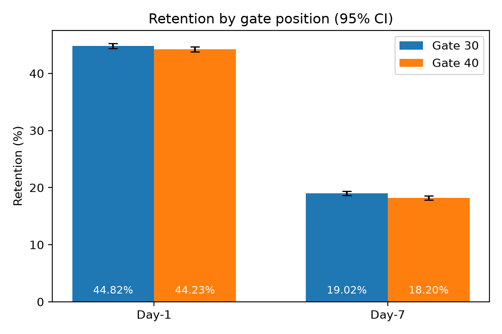
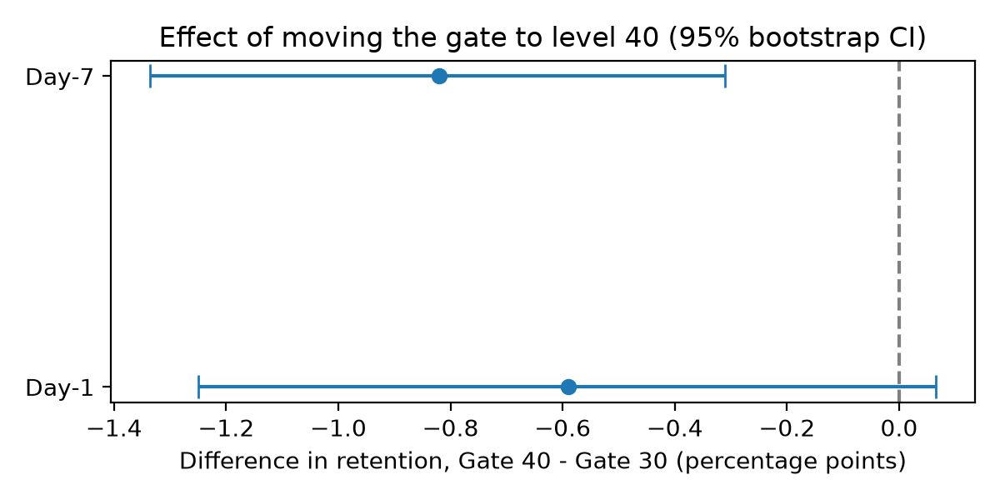

# Cookie Cats A/B Test Analysis

Did moving the first gate in the mobile game *Cookie Cats* from level 30 to level 40 change player retention?

## Summary
- Analyzed an A/B test of about 90,000 players using SQL (SQLite) and Python.
- Moving the gate to level 40 was associated with **lower Day-7 retention**: -0.82 percentage points (95% bootstrap CI [-1.34, -0.31], p = 0.0016).
- Day-1 retention showed no statistically significant change (-0.59 pp, CI [-1.25, +0.07], p = 0.0744).
- Results held after excluding extreme players and under a stricter significance threshold.
- **Recommendation:** keep the gate at level 30. See [reports/memo.md](reports/memo.md).

## Results





Error bars in the first chart are 95% Wilson confidence intervals for each group's retention rate. The second chart shows the 95% bootstrap confidence interval for the difference (Gate 40 - Gate 30).

## Data
Kaggle dataset "Mobile Games A/B Testing - Cookie Cats" (columns: `userid`, `version`, `sum_gamerounds`, `retention_1`, `retention_7`). Place `cookie_cats.csv` in `data/raw/`.

## Methods
- SQL: loading, data quality checks (duplicates, outliers), retention by group.
- Statistics: two-proportion z-tests, bootstrap confidence intervals, effect sizes, power analysis, sample ratio check, outlier robustness check, multiple-testing consideration.

## Limitations
- Mild sample ratio mismatch (chi-square p = 0.0086) of unknown cause.
- No revenue or purchase data, so the full business impact is not measured.
- Only Day-1 and Day-7 retention; reasons for churn are unknown.

## Repository structure
```
data/raw/            original CSV
data/                SQLite database (created by the notebook)
sql/                 SQL queries
notebooks/           analysis notebook
src/                 helper functions
reports/             memo and figures
```

## How to reproduce
```bash
pip install -r requirements.txt
jupyter notebook notebooks/ab_test.ipynb
```

## Tools
Python (pandas, SciPy, statsmodels, matplotlib), SQLite, Jupyter.